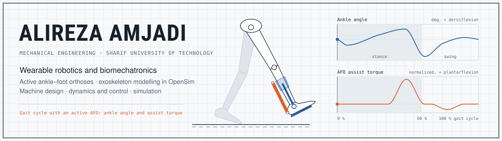

<picture>
  <source media="(prefers-color-scheme: dark)" srcset="banner/banner-dark.svg">
  
</picture>

  <a href="https://alireza-amjadi.github.io"><b>Portfolio</b></a> ·
  <a href="https://alireza-amjadi.github.io/assets/cv/Alireza_Amjadi_CV.pdf"><b>CV</b></a> ·
  <a href="https://www.linkedin.com/in/alireza-amjadi"><b>LinkedIn</b></a> ·
  <a href="mailto:alireza_amjadi@mech.sharif.edu"><b>Email</b></a>

I am a B.Sc. student in Mechanical Engineering at **Sharif University of Technology**, in the **Dynamics, Control and Vibration** track (GPA 18.69/20, ranked 11th of 126). My B.Sc. project, supervised by Prof. Farzam Farahmand, is on **active ankle–foot orthoses** for stroke survivors with drop foot, and I am responsible for its musculoskeletal modelling in **OpenSim**. I am looking for **MSc positions from Fall 2027** in wearable robotics and biomechatronics.

## Research

- **B.Sc. project** · Fall 2026 – present Active ankle–foot orthoses for post-stroke drop foot: modelling and simulation of the human–orthosis system in OpenSim. Supervisor: [Prof. Farzam Farahmand](https://scholar.google.com/citations?user=lUslt-MAAAAJ).
- **Interests** Biomechatronics · wearable robotics and exoskeletons · active orthoses and assistive devices · rehabilitation robotics · musculoskeletal modelling and simulation · gait biomechanics · dynamics and control · physics-informed machine learning

## Projects

Newest first. Each repository contains the full report in English and the original report in Persian, together with the code or models where the project has them.

| Project | Course · Term | Tools |
|:--|:--|:--|
| [**pump-mechanism-flywheel**](https://github.com/Alireza-Amjadi/pump-mechanism-flywheel) Multibody simulation of an oscillating-cylinder pump and flywheel design | Dynamics of Machinery · Spring 2026 | Simscape Multibody, MATLAB |
| [**dc-motor-pi-control**](https://github.com/Alireza-Amjadi/dc-motor-pi-control) Modelling and PI speed control of a separately excited DC motor | Fundamentals of Electrical Engineering II · Spring 2026 | MATLAB/Simulink |
| [**power-electronics-hybrid-cooling**](https://github.com/Alireza-Amjadi/power-electronics-hybrid-cooling) Transient finite-volume solver for a liquid–air cooled heat sink, validated with ANSYS | Heat Transfer I · Spring 2026 | MATLAB, ANSYS Mechanical |
| [**airfoil-flow-three-methods**](https://github.com/Alireza-Amjadi/airfoil-flow-three-methods) Flow around the NACA 4421 and NACA 16-006 airfoils with ANSYS Fluent, PINNs and a source–sink method | Fluid Mechanics II · Fall 2025 | ANSYS Fluent, PyTorch, MATLAB |
| [**gearbox-gears-final-design**](https://github.com/Alireza-Amjadi/gearbox-gears-final-design) Helical and bevel gear design and final layout of the gearbox | Machine Elements Design II · Fall 2025 | SolidWorks, FEA |
| [**mine-winch-flexible-transmission**](https://github.com/Alireza-Amjadi/mine-winch-flexible-transmission) Belts, wire rope, chain, drum and chassis of a mine haulage winch | Machine Elements Design II · Fall 2025 | SolidWorks |
| [**gearbox-shafts-bearings-housing**](https://github.com/Alireza-Amjadi/gearbox-shafts-bearings-housing) Shafts, keys, SKF bearings and welded housing of an industrial gearbox | Machine Elements Design II · Fall 2025 | SolidWorks, FEA |
| [**pinn-3d-pipe-flow**](https://github.com/Alireza-Amjadi/pinn-3d-pipe-flow) 3D physics-informed neural network for laminar pipe flow, checked against the Hagen–Poiseuille solution | Fluid Mechanics I · Spring 2025 | Python, NumPy, SciPy |
| [**forklift-jib-crane-design**](https://github.com/Alireza-Amjadi/forklift-jib-crane-design) Bolted and welded joint design of a fork-mounted jib crane | Machine Elements Design I · Spring 2025 | SolidWorks, MATLAB |

## Skills

**Biomechanics and dynamics:** OpenSim · Simscape Multibody · Simulink · multibody dynamics · control design 
**Computational mechanics:** ANSYS Fluent and Mechanical · finite-volume methods · verification and validation 
**Programming and machine learning:** Python (NumPy, SciPy, PyTorch) · MATLAB · physics-informed neural networks 
**CAD and mechanical design:** SolidWorks · CATIA · FEA · fatigue design of gears, shafts and bearings

The banner is generated by [`banner/make_banner.py`](banner/make_banner.py): hip, knee and ankle angles follow typical normative gait curves, and the AFO assist-torque profile is illustrative.
